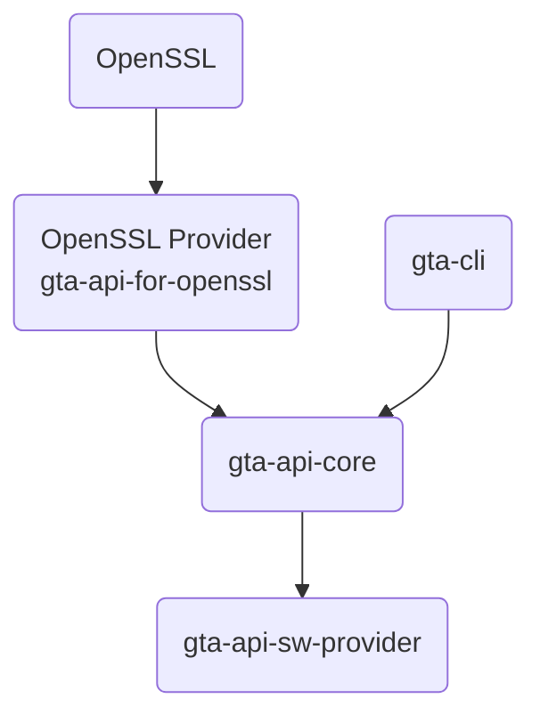

<!--
SPDX-FileCopyrightText: Copyright 2025-2026 Siemens

SPDX-License-Identifier: Apache-2.0
-->

# GTA API for OpenSSL - Proof-Of-Concept OpenSSL Provider

__DISCLAIMER:__
This code is a proof-of-concept for establishing a TLS connection and using CMP with OpenSSL
and using the GTA API to create and store the credentials. In an example, GTA API is
called in a custom OpenSSL provider for the client authentication during the TLS
handshake.

Current limitations in OpenSSL provider:
* No proper error handling.
* Probably some memory leaks.
* Currently supports ECC (tested with NIST P-256), RSA (tested with RSA 2048) and ML-DSA-65.
* CA certificate protection:
  * Currently not supported in TLS example, because `s_client` does not use the provider to load the certificate.
  * Supported in CMP example.

Additional feature:
* Send certificate signing request with [RFC 4210](https://datatracker.ietf.org/doc/html/rfc4210) protocol.
* Send certificate key update request with [RFC 4210](https://datatracker.ietf.org/doc/html/rfc4210) protocol.
* Protect the CA certificates in case of [RFC 4210](https://datatracker.ietf.org/doc/html/rfc4210) protocol.

Component structure:


### Structure of the Repository
| File        | Description |
| :---        |      :---   |
| ./meson_options.txt | Project‑specific configuration options used by the Meson build system |
| ./provider  | OpenSSL provider implementation for using the GTA API framework/middleware and GTA API Software Provider |
| ./tests     | Integration tests to cover the demo scenarios (TLS handshake, generate CMP message) |
| ./demo      | TLS client/server and CMP demo |
| ./deps      | Installation directory of the GTA API Software Provider as a "merged static library" |

## Prerequisite 
The following tools and libraries need to be installed for build and run the demo project.

### Build dependencies

- __GTA API Core:__ Generic Trust Anchor API for Industrial IoT devices. Details are described in [ISO/IEC TS 30168](https://www.iso.org/standard/53288.html).
    * Follow the installation guideline on the [GTA API Core](https://github.com/generic-trust-anchor-api/gta-api-core.git) web page.  

- __GTA API Software Provider:__ Generic Trust Anchor API SW Provider. This project implements a Software-based Provider for the Generic Trust Anchor API and can be used by gta-api-core.
    * A `merged static library` is needed for the OpenSSL Provider. It can be downloaded as build artifact from the [GTA Software Provider](https://github.com/generic-trust-anchor-api/gta-api-sw-provider.git) project.

- __Additional development and test packages:__
    * __strace__: to intercept and record the system calls or event of an application.
    * __meson:__ Python-based build system generator like Automake or CMake
    * __ninja-build:__ Build tool like make
    * __build-essential:__ Meta-package to install a full build environment on Debian-based systems
    * __libssl-dev:__ Development package for OpenSSL. For non-PQC builds (enable-post-quantum-crypto=false), OpenSSL >= 3.0.0 is required; for PQC-enabled builds (enable-post-quantum-crypto=true), OpenSSL >= 3.5.0 is required.
    * __pkg-config:__ Tool required by meson to figure out compiler/linker options for library dependencies
  
    Install command in case of the debian based Linux: 
    ```
    $ apt -y install meson ninja-build build-essential curl git unzip llvm llvm-dev strace pkg-config python3 libssl-dev
    ```   

### Runtime dependencies 

- __OpenSSL runtime requirement:__ When the provider is compiled with PQC enabled (enable-post-quantum-crypto=true), OpenSSL >= 3.5.0 is required. When PQC is disabled (enable-post-quantum-crypto=false), OpenSSL >= 3.0.0 is required.

- __GTA CLI:__ GTA API command line interface to call the GTA SW provider.
    * Follow the installation guideline on the [gta_cli](https://github.com/generic-trust-anchor-api/gta-cli.git) web page. 
      
## Build demo

* Compile and install the OpenSSL provider and helper programs:
  ```
  $ meson setup <build_dir>

  $ ninja -C <build_dir>

  $ sudo ninja -C <build_dir> install
  ```

  For a PQC-enabled build, use:
  ```
  $ meson setup <build_dir> -Denable-post-quantum-crypto=true
  ```

  For a non-PQC build, use:
  ```
  $ meson setup <build_dir>
  ```
  or
  ```
  $ meson setup <build_dir> -Denable-post-quantum-crypto=false
  ```

  If OpenSSL is installed in a non-standard location, override the detected provider directory explicitly:
  ```
  $ meson setup <build_dir> -Dopenssl_modules_dir=/path/to/ossl-modules
  ```

##### Available Meson options:

| **Option Name** | **Type** | **Default Value** | **Description** |
|-------------|------|----------------|-------------|
| openssl_modules_dir | string | empty (auto-detected) | OpenSSL provider directory override |
| gta_state_directory | string | . | Directory to store the state of the GTA API SW provider in case the environment variable `GTA_STATE_DIRECTORY` is not present |
| enable-post-quantum-crypto | boolean | false | Enable PQC |
| log_level | integer | 0 | Log level (TRACE 0, DEBUG 1, INFO 2, WARN 3, ERROR 4) |
| log_b64_on | boolean | true | Enable showing base64 decoded data in the log |
| log_byte_array_on | boolean | false | Enable showing byte array data in the log |
| log_for_cycle_on | boolean | false | Enable showing state of the for cycle in the log |

## Run TLS demo

* Change to the `demo` directory and create the necessary keys and certificates:
    * __Elliptic Curve__ key material and certificates: 
        ```
            cd demo/tls
            ./prepare_tls_demo.sh ec
        ```

* In one terminal change into the server directory and start the server:
  ```
  cd server
  ./start_server.sh
  ```
* In another terminal change into the client directory and start the client:
  ```
  cd client
  ./start_client.sh
  ```

## Run CMP demo

* Change to the `demo` directory and create the necessary keys and certificates:
    * __CMP__ key materials and certificates: 
        ```
            cd demo/cmp
            ./prepare_cmp_demo.sh
        ```

* Run the cmp client to request a certificate:
  ```
  ./send_cr_cmp_message.sh
  ```
* Run the cmp client to send a key update request:
  ```
  ./send_kur_cmp_message.sh
  ```

## Run integration tests
* Test OpenSSL provider and helper programs:
  ```
  $ ninja -C <build_dir>

  $ sudo ninja -C <build_dir> install
  
  $ ninja -C <build_dir> test
  ```
